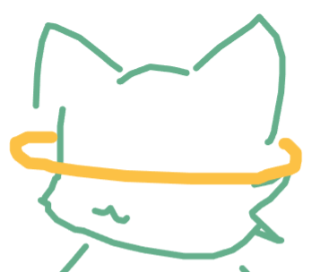

  

  

  

---

  

  

---

  

  

   
   
  

---

  

<table align="center">
  <tr>
    <td align="center">
       
       
      
    </td>
    <td align="center">
       
       
      
    </td>
  </tr>
</table>

---

  

  
  
  
  
  
  
  

---

  

  

  

